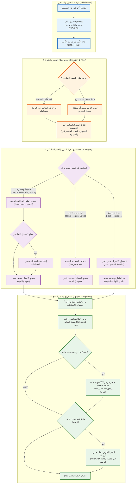

# إضافة حصر الكميات للمخططات في أوتوكاد (AutoCAD Quantity Takeoff - QTO)

أداة متكاملة وسريعة لحصر الكميات من المخططات الهندسية داخل برنامج **AutoCAD** (تعمل على كافة إصدارات أوتوكاد الحديثة والقديمة).

---

## 🗺️ خريطة سير العمل وآلية عمل الأداة (Workflow Map)

يوضح المخطط الانسيابي التالي مسار العمل الكامل من لحظة تشغيل الإضافة حتى استخراج تقارير الكميات:



---

## 🌟 مميزات الإضافة

1. **حصر الأطوال (Linear Takeoff):**
   - حساب أطوال الخطوط، الخطوط المتعددة (`Polylines` / `LWPolylines`)، الأقواس (`Arcs`)، والمنحنيات (`Splines`).
   - تجميع الأطوال تلقائياً حسب اسم الطبقة (`Layer`).
2. **حصر المساحات (Area Takeoff):**
   - حساب مساحات التهشير (`Hatch`) ومساحات المضلعات والأشكال المغلقة (`Closed Polylines`, `Circles`, `Regions`).
   - تجميع المساحات تلقائياً بالمتر المربع (أو بوحدة الرسم) حسب الطبقة.
3. **حصر البلوكات والعناصر (Block Counts):**
   - عدّ جميع البلوكات والرموز (أبواب، نوافذ، أثاث، وحدات إنارة، قواطع، صحي، إلخ).
   - دعم **البلوكات الديناميكية (Dynamic Blocks)** واستخراج اسمها الحقيقي وليس الأسماء العشوائية `*U...`.
4. **طرق إخراج متعددة للنتائج:**
   - **في سطر الأوامر (Command Line):** جدول نصي ملخص فوري.
   - **تصدير إلى ملف Excel (CSV):** ملف منظم متوافق مع اللغة العربية بترميز (UTF-8 BOM) بدون تشوه في الأحرف.
   - **إدراج جدول أوتوكاد (AutoCAD Table):** رسم جدول كميات أنيق مباشرة داخل لوحة الرسم بجانب المخطط.

---

## 🚀 طريقة التثبيت والتشغيل داخل أوتوكاد

### الطريقة الأولى: السحب والإفلات (الأسهل والأسرع)
1. افتح برنامج أوتوكاد وافتح المخطط المراد حصره.
2. اسحب ملف [`QTO.lsp`](file:///Users/anl7j/Downloads/Download%20in%20Google%20chrome/h/QTO.lsp) وأفلته بالماوس مباشرة داخل شاشة الرسم في أوتوكاد.
3. ستظهر رسالة في سطر الأوامر تفيد بنجاح التحميل.

---

### الطريقة الثانية: عبر أمر `APPLOAD`
1. في أوتوكاد، اكتب في شريط الأوامر:
   ```text
   APPLOAD
   ```
   ثم اضغط `Enter`.
2. استعرض وحدد مكان الملف [`QTO.lsp`](file:///Users/anl7j/Downloads/Download%20in%20Google%20chrome/h/QTO.lsp).
3. اضغط على زر **Load**.

---

### 📌 التشغيل التلقائي عند فتح أوتوكاد دائماً (Startup Suite)
لكي لا تحتاج لتحميل الملف في كل مرة تفتح فيها أوتوكاد:
1. اكتب `APPLOAD` واضغط `Enter`.
2. في زاوية النافذة السفلية، ستجد قسم **Startup Suite** وعليه أيقونة حقيبة سفر (Briefcase).
3. اضغط على زر **Contents...**.
4. اضغط على **Add...** واختر ملف [`QTO.lsp`](file:///Users/anl7j/Downloads/Download%20in%20Google%20chrome/h/QTO.lsp)، ثم اضغط **Close**.
5. الآن ستعمل الإضافة تلقائياً في أي وقت تفتح فيه أوتوكاد!

---

## 🎯 كيفية الاستخدام (أوامر التشغيل)

1. في شريط أوامر أوتوكاد، اكتب أحد الأمرين:
   - `QTO`
   - أو `HASR`
2. سيطلب منك البرنامج اختيار نطاق الحصر:
   - اضغط `Enter` لحصر **كامل المخطط (All)**.
   - أو اكتب `S` أو `تحديد` لتحديد عناصر أو منطقة معينة بالماوس (Selection Window).
3. سيقوم البرنامج فوراً بالعمليات التالية:
   - عرض ملخص الحصر في شريط الأوامر.
   - سؤالك عن تصدير التقرير لـ **Excel (CSV)** (اضغط `Enter` للموافقة واختيار مكان الحفظ).
   - سؤالك عن إدراج **جدول داخل الرسم (AutoCAD Table)** (اختر نعم وانقر بالماوس في المكان المناسب لوضع الجدول).

---

## 🐍 أداة بايثون المستقلة (لحصر ملفات DXF بدون فتح أوتوكاد)

إذا كنت تفضل حصر ملفات المخططات برمجياً وبشكل دفعات بدون فتح أوتوكاد، تم إرفاق سكربت [`qto_dxf.py`](file:///Users/anl7j/Downloads/Download%20in%20Google%20chrome/h/qto_dxf.py):

### المتطلبات:
```bash
pip install ezdxf
```

### الاستخدام:
```bash
python qto_dxf.py "المخطط.dxf"
```
سيقوم السكربت بحصر الأطوال والمساحات والبلوكات وطباعتها وتصديرها تلقائياً إلى ملف CSV.
